  <picture>
    <source media="(prefers-color-scheme: dark)" srcset="./assets/header-dark.svg">
    <source media="(prefers-color-scheme: light)" srcset="./assets/header-light.svg">
    
  </picture>

<h3 align="center">Cloud Architect &amp; DevOps Engineer</h3>

  I work and learn around <b>Devopsecops</b>, <b>Infrastructure</b>, <b>Cloud</b> &amp; <b>Learning IA</b> 
  <a href="https://www.linkedin.com/in/pazhani-swamy-saminathan-869a67254/">LinkedIn</a>

  <picture>
    <source media="(prefers-color-scheme: dark)" srcset="./assets/ticker-dark.svg">
    <source media="(prefers-color-scheme: light)" srcset="./assets/ticker-light.svg">
    
  </picture>

  <picture>
    <source media="(prefers-color-scheme: dark)" srcset="./assets/divider-dark.svg">
    <source media="(prefers-color-scheme: light)" srcset="./assets/divider-light.svg">
    
  </picture>

## 🧭 Currently working on

A public learning path on AWS: one real project per stage, each one built by me, broken on purpose and documented as I go.

  <picture>
    <source media="(prefers-color-scheme: dark)" srcset="./assets/stages-dark.svg">
    <source media="(prefers-color-scheme: light)" srcset="./assets/stages-light.svg">
    
  </picture>

  <picture>
    <source media="(prefers-color-scheme: dark)" srcset="./assets/terminal-dark.svg">
    <source media="(prefers-color-scheme: light)" srcset="./assets/terminal-light.svg">
    
  </picture>

➡️ Follow it in **[devops-project-learning](https://github.com/Pazhani-Swamy/devops-project-learning)**

  <picture>
    <source media="(prefers-color-scheme: dark)" srcset="./assets/divider-dark.svg">
    <source media="(prefers-color-scheme: light)" srcset="./assets/divider-light.svg">
    
  </picture>

## 📌 Featured projects

| Project | Description | Stack |
|---|---|---|
| [devops-project-learning](https://github.com/Pazhani-Swamy/devops-project-learning) | A progressive, hands-on path from Docker to AI-assisted infrastructure, one real-world project per stage. Stage 02 (containers) in progress | Docker, GitLab CI / GitHub Actions, Terraform, Ansible, AWS, EKS, ArgoCD, Prometheus/Grafana, Trivy, AI |
| [Terraform_5SRC1](https://github.com/Pazhani-Swamy/Terraform_5SRC1) | Infrastructure as Code with Terraform | HCL |
| [esgi-devsecops](https://github.com/Pazhani-Swamy/esgi-devsecops) | Course artifacts from the DevSecOps module at ESGI | HCL |

## 🎯 Goal

I document my projects around DevSecOps, cloud infrastructure and web development here, as part of a continuous learning approach. I build things myself, break them on purpose, and write down what I learn.
